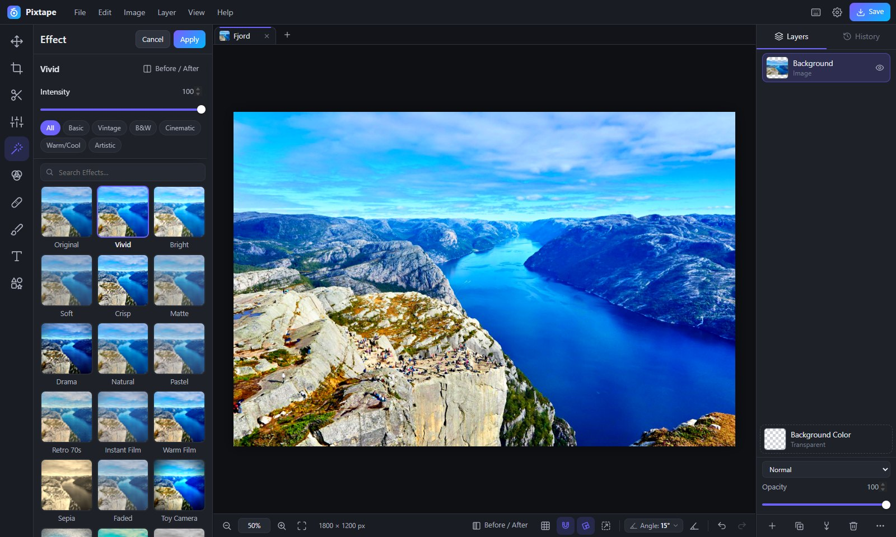
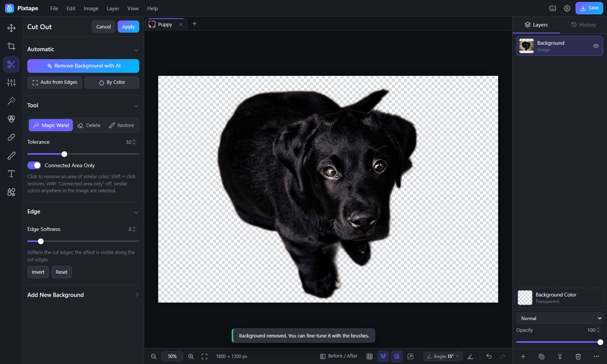
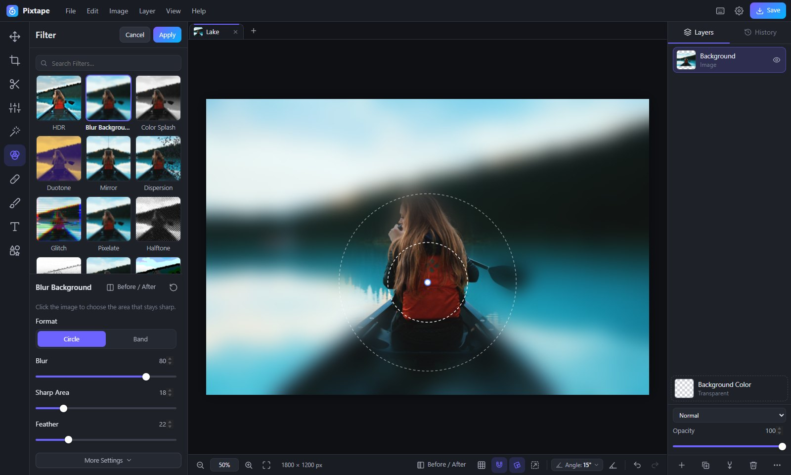
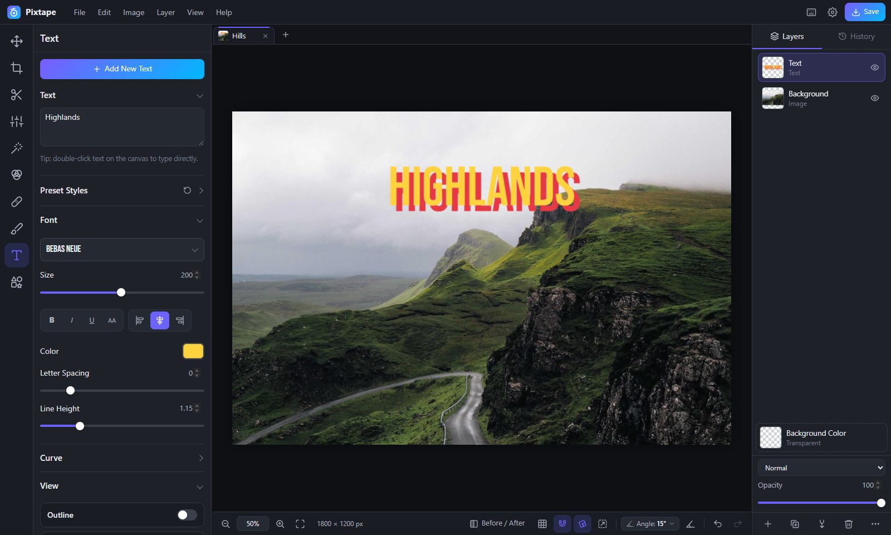
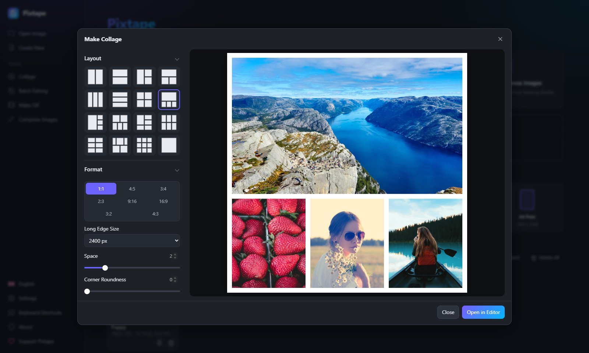

# Pixtape

A free, easy photo editor for your browser. No sign-up, no ads, and your photos are never uploaded.

**[Open Pixtape](https://pixtape.github.io)**

## Features

- **Edit:** crop, straighten, resize, adjust light and color, curves, 50 one-click effects, 22 filters
- **Retouch:** spot heal, remove objects, clone, smooth skin, red eye, blur and censor
- **Cut out:** AI background removal, remove a color, magic wand, erase and restore brushes
- **Create:** text with 120+ fonts, drawing, shapes, stickers, frames, layers and groups
- **More:** collage, batch editing, GIF and MP4 maker, image compressor, project tabs
- **Languages:** English, Türkçe, 中文, Русский

## Screenshots

| AI background removal | Blur background |
|---|---|
|  |  |
| **Text with 120+ fonts** | **Collage** |
|  |  |

## Good to know

- Your photos are never uploaded to a server. AI background removal downloads its model (about 40 MB) once, the first time you use it.
- Projects are saved automatically in your browser. Clearing the browser's site data deletes them, so use *File → Save project (.pixtape)* for backups.
- Keyboard shortcuts can be changed in *Help → Keyboard shortcuts*.

## Contributing

Bug reports, ideas and translations are welcome in [Issues](https://github.com/pixtape/pixtape.github.io/issues). Pixtape is plain HTML, CSS and JavaScript with no build step: open `index.html` through any local web server to run it.

## License

Copyright (C) 2026 bcanusar

Pixtape is free software: you can redistribute it and/or modify it under the terms of the [GNU Affero General Public License v3.0](LICENSE). If you run a modified version for others over a network, you must share its source code under the same license. Third-party icons, fonts and libraries are under their own licenses, see [THIRD-PARTY-NOTICES.txt](THIRD-PARTY-NOTICES.txt).

Photos in the screenshots are from [Unsplash](https://unsplash.com) by Alexey Topolyanskiy, Alexander Shustov, Roberto Nickson, Andrew Ridley, veeterzy and André Spieker, used under the [Unsplash License](https://unsplash.com/license).

## Support

If you like Pixtape, you can support its development: [github.com/sponsors/bcanusar](https://github.com/sponsors/bcanusar)
